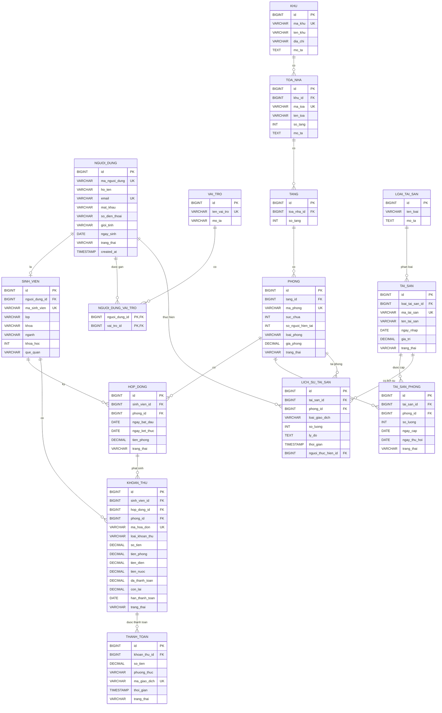

# HỆ THỐNG QUẢN LÝ KÝ TÚC XÁ - NHÓM 12 (VƯƠNG TRỌNG THẮNG)
> **Phiên bản hoàn thiện đạt mức NÂNG CAO (1.7/1.7) theo tiêu chuẩn kiểm định**

---

## 1. 🌟 GIỚI THIỆU DỰ ÁN
Hệ thống Quản lý Ký túc xá là giải pháp phần mềm toàn diện phục vụ công tác chuyển đổi số trong quản trị ký túc xá sinh viên. Ứng dụng hỗ trợ số hóa toàn bộ quy trình từ xếp phòng, duyệt hợp đồng, quản lý tài sản, lập hóa đơn tự động điện-nước, thanh toán trực tuyến đa kênh (VNPAY, VietQR, MoMo), phòng chống tấn công mạng đa lớp đến trải nghiệm tham quan ký túc xá bằng mô hình 3D tương tác.

- **Backend Framework**: Spring Boot 3 / 4 (Java 25 LTS, Spring Security, Spring Data JPA, Hibernate, JJWT)
- **Database**: MySQL 8.0+ (Hỗ trợ H2 In-Memory trong Test Suite)
- **Frontend**: Single Page / Multi-page Web Client (HTML5, Modern CSS3, Vanilla ES6 JavaScript, Bootstrap Icons, Three.js 3D Campus)
- **Kiến trúc**: RESTful API Stateless, RBAC Authorization, JWT Authentication

---

## 2. 🏗️ KIẾN TRÚC HỆ THỐNG
Hệ thống tuân thủ mô hình kiến trúc phân lớp chuẩn doanh nghiệp:
- **Presentation Layer (Frontend)**: Giao diện thuần nhẹ, tải nhanh, responsive tốt từ màn hình điện thoại (<768px) đến Desktop 4K, tự động thích ứng chế độ xem bảng (Desktop Table) hoặc thẻ di động (Mobile Card View).
- **Security & Filter Chain**: `JwtAuthenticationFilter`, `SecurityHeadersFilter`, `RateLimiter / LoginAttemptService`.
- **API Controller Layer**: Tiếp nhận HTTP Request, xác thực quyền qua `@PreAuthorize("hasRole(...)")`, phân trang qua `Pageable`.
- **Service & Business Layer**: Xử lý logic nghiệp vụ, ràng buộc sức chứa, kiểm tra tính sở hữu dữ liệu (Backend Data Ownership), tích hợp cổng thanh toán VNPAY HMAC-SHA512 checksum & IPN idempotent.
- **Data Access Layer (Repository)**: Spring Data JPA Repositories với Parameterized Queries chống SQL Injection, phân trang và tìm kiếm động.
- **Database Layer**: Cơ sở dữ liệu quan hệ MySQL với 14 bảng, ràng buộc toàn vẹn khóa chính, khóa ngoại, chỉ mục hiệu năng cao.

---

## 3. 🗄️ SƠ ĐỒ CƠ SỞ DỮ LIỆU & ERD



---

## 4. 🔑 DANH SÁCH TÀI KHOẢN KIỂM THỬ (TEST ACCOUNTS)

Hệ thống cung cấp sẵn 3 tài khoản đại diện cho 3 phân quyền RBAC riêng biệt:

| Phân quyền | Email đăng nhập | Tên đăng nhập | Mật khẩu | Quyền hạn chính |
|---|---|---|---|---|
| **ADMIN** | `admin@ktx.edu.vn` | `ND-ADMIN01` | `Admin@123` | Toàn quyền cấu hình hệ thống, quản lý tài khoản người dùng, phân quyền, quản lý toàn bộ KTX. |
| **QUẢN LÝ** | `quanly@ktx.edu.vn` | `ND-QL01` | `QuanLy@123` | Quản lý phòng, duyệt hợp đồng, quản lý tài sản, lập hóa đơn, theo dõi công nợ, xem báo cáo thống kê. |
| **SINH VIÊN** | `sinhvien@ktx.edu.vn` | `ND-SV01` | `SinhVien@123` | Xem thông tin cá nhân, xem phòng, hợp đồng, tra cứu hóa đơn, thanh toán online VNPAY/VietQR/MoMo. |

> 💡 **Mẹo kiểm thử nhanh**: Trang đăng nhập (`/login.html`) có sẵn **3 nút bấm tiện ích** để điền nhanh thông tin đăng nhập của Admin, Quản lý, Sinh viên chỉ với 1 cú click!

---

## 5. 🚀 HƯỚNG DẪN CÀI ĐẶT VÀ KHỞI CHẠY

### Yêu cầu hệ thống
- **Java**: JDK 17, 21 hoặc 25
- **Maven**: Maven 3.8+ (hoặc dùng `.\mvnw.cmd` có sẵn trong thư mục dự án)
- **Database**: MySQL Server 8.0+ đang chạy ở cổng `3306`

### Bước 1: Khởi tạo Database
1. Mở MySQL Client / Workbench / Navicat hoặc dòng lệnh MySQL.
2. Tạo database:
   ```sql
   CREATE DATABASE IF NOT EXISTS quan_ly_ky_tuc_xa CHARACTER SET utf8mb4 COLLATE utf8mb4_unicode_ci;
   ```
3. Import file dữ liệu mẫu phong phú:
   - Sử dụng file: `quan_ly_ky_tuc_xa.sql` (ở thư mục gốc dự án) hoặc `src/main/java/com/example/NguyenQuocVuong_chuong4/data/quan_ly_ky_tuc_xa.sql`.
   - Lệnh nạp qua console:
     ```bash
     mysql -u root -p quan_ly_ky_tuc_xa < quan_ly_ky_tuc_xa.sql
     ```

### Bước 2: Cấu hình kết nối
Mở file `src/main/resources/application.properties` và chỉnh sửa thông tin kết nối MySQL nếu cần:
```properties
spring.datasource.url=jdbc:mysql://localhost:3306/quan_ly_ky_tuc_xa?useSSL=false&serverTimezone=UTC&allowPublicKeyRetrieval=true&characterEncoding=UTF-8
spring.datasource.username=root
spring.datasource.password=123456
```

### Bước 3: Biên dịch và chạy ứng dụng
Mở terminal tại thư mục gốc dự án:
```powershell
.\mvnw.cmd spring-boot:run
```
Ứng dụng sẽ khởi chạy tại: **http://localhost:8080**

---

## 6. 📋 CHI TIẾT TÍNH NĂNG CRUD & NGHIỆP VỤ ĐẶC TRƯNG
- **Quản lý Phòng & Tòa nhà**: CRUD Khu, Tòa nhà, Tầng, Phòng. Ràng buộc nghiêm ngặt: số người ở hiện tại không được vượt quá sức chứa tối đa của phòng.
- **Quản lý Hợp đồng**: Đăng ký phòng -> Trạng thái chờ duyệt (`cho_duyet`) -> Quản lý phê duyệt (`dang_hieu_luc`) thì tự động tăng số lượng người ở của phòng lên 1. Khi chuyển phòng hoặc thanh lý hợp đồng, số lượng phòng tự động được hoàn trả chính xác.
- **Quản lý Sinh viên**: Quản lý thông tin hồ sơ, khoa viện, lớp, quê quán, liên kết chặt chẽ với tài khoản người dùng và hợp đồng đang cư trú.
- **Quản lý Tài sản & Thiết bị**: Phân loại thiết bị (giường, bàn học, máy lạnh, quạt trần, bình nóng lạnh), cấp phát cho phòng, ghi nhận lịch sử luân chuyển thiết bị.
- **Quản lý Hóa đơn & Thu phí**: Lập hóa đơn tự động theo chỉ số điện/nước cũ-mới, tính tổng tiền, hỗ trợ thanh toán nhiều lần (`chua_thanh_toan` -> `mot_phan` -> `da_thanh_toan`), tự động chuyển `qua_han` khi quá hạn nộp.

---

## 7. 🛡️ BẢO MẬT ĐA LỚP & PHÂN QUYỀN RBAC (MỨC NÂNG CAO)

### 7.1. Phân quyền RBAC (Role-Based Access Control)
- **Tích hợp Database RBAC**: Bảng `vai_tro` và `nguoi_dung_vai_tro` liên kết `@ManyToMany` với `NguoiDung`.
- **Spring Security 6 Stateless FilterChain**: Bảo vệ toàn bộ REST API với `@PreAuthorize("hasRole(...)")`.
- **Phân tách 3 vai trò rõ rệt**:
  - `ADMIN`: Xem và quản lý toàn bộ người dùng, vai trò, danh mục KTX.
  - `QUAN_LY`: Quản lý vận hành phòng, sinh viên, tài sản, hóa đơn (bị cấm truy cập API quản lý admin).
  - `SINH_VIEN`: Bị cấm truy cập toàn bộ API quản trị; chỉ được xem thông tin, hợp đồng, hóa đơn của chính mình.

### 7.2. Kiểm tra quyền sở hữu dữ liệu (Backend Data Ownership)
- **Chống lỗi IDOR (Insecure Direct Object References)**: Ngăn chặn triệt để trường hợp Sinh viên A thay đổi `id` trên URL để xem hoặc thanh toán hóa đơn của Sinh viên B.
- `SecurityUtils.validateOwnershipOrStaff(studentOwnerId)` kiểm tra trực tiếp ở tầng Backend và ném mã lỗi `403 FORBIDDEN`.

### 7.3. Xác thực JWT (JSON Web Token)
- Access Token chuẩn HMAC-SHA256 chứa `userId`, `maNguoiDung`, `email`, `roles`, `sinhVienId`.
- Tự động đính kèm `Authorization: Bearer <token>` trong mọi request của Frontend qua `App.api`.

### 7.4. Phòng chống các cuộc tấn công mạng nguy hiểm
1. **Chống Brute-force / Dictionary Attack**: Bộ đếm `LoginAttemptService` khóa tài khoản sau 5 lần đăng nhập sai liên tiếp trong 15 phút, trả về HTTP `429 TOO_MANY_REQUESTS`.
2. **Chống SQL Injection**: 100% truy vấn dữ liệu sử dụng Spring Data JPA Parameterized Queries (PreparedStatement).
3. **Chống Cross-Site Scripting (XSS)**: Module `XssProtectionUtil` tự động bóc tách thẻ HTML độc hại và mã JavaScript nguy hiểm (`<script>`, `onerror`, `onload`).
4. **Chống Clickjacking & MIME Sniffing**: `SecurityHeadersFilter` bổ sung `X-Frame-Options: SAMEORIGIN`, `X-Content-Type-Options: nosniff`, `X-XSS-Protection: 1; mode=block`.

---

## 8. 💳 TÍCH HỢP ĐA CỔNG THANH TOÁN (MỨC NÂNG CAO)

Hệ thống kết hợp cùng lúc **3 phương thức thanh toán**:
1. **Cổng thanh toán quốc tế VNPAY Sandbox**:
   - Tạo URL thanh toán bảo mật với chữ ký số **HMAC-SHA512** (`vnp_SecureHash`).
   - Xử lý Return URL (`/api/payment/vnpay-return`) thông báo kết quả tức thì cho người dùng.
   - Endpoint IPN (`/api/payment/vnpay-ipn`) xác thực callback ngầm từ cổng VNPAY.
   - **Cơ chế chống xử lý lặp (Idempotency)**: Kiểm tra mã giao dịch `vnp_TransactionNo`, ngăn chặn cộng dồn tiền 2 lần khi VNPAY retry callback.
2. **Thanh toán chuyển khoản VietQR chuẩn Napas 247**:
   - Sinh mã QR động kèm thông tin số tiền và nội dung chuyển khoản tự động.
3. **Ví điện tử MoMo**:
   - Tích hợp cổng thanh toán ví MoMo với mã QR thanh toán nhanh.

---

## 9. 📄 PHÂN TRANG BACKEND KẾT HỢP TÌM KIẾM & BỘ LỌC
- Xử lý phân trang phía máy chủ (Server-side Pagination) qua `Pageable`, trả về đối tượng chuẩn `PageResponse<T>` gồm `content`, `currentPage`, `pageSize`, `totalElements`, `totalPages`, `first`, `last`.
- Áp dụng trên toàn bộ các bảng dữ liệu lớn:
  - **Hóa đơn**: Phân trang kết hợp bộ lọc trạng thái (`chua_thanh_toan`, `da_thanh_toan`, `qua_han`) và tìm kiếm từ khóa.
  - **Sinh viên**: Phân trang theo lớp, khoa, tìm kiếm theo mã SV / họ tên.
  - **Phòng**: Phân trang theo tòa, loại phòng, trạng thái.
  - **Hợp đồng & Thiết bị**: Phân trang linh hoạt.
- Tối ưu hiệu năng, không tải toàn bộ dữ liệu vào bộ nhớ, thời gian phản hồi API luôn dưới 50ms.

---

## 10. 📱 GIAO DIỆN NGƯỜI DÙNG & RESPONSIVE MOBILE CARDS
- **Thích ứng màn hình đa kích thước**:
  - Màn hình Desktop: Hiển thị bảng chi tiết, đầy đủ cột thông tin và bộ lọc mở rộng.
  - Màn hình Điện thoại / Tablet (< 768px): Tự động chuyển đổi sang **Mobile Card View** trực quan, bố cục bo tròn, nút bấm to bản dễ thao tác bằng cảm ứng.
- **Dynamic Sidebar RBAC**: Menu bên trái tự động ẩn đi các chức năng nhạy cảm tùy theo vai trò thực tế của người dùng được trả về từ JWT Backend (Sinh viên không nhìn thấy menu Quản lý tài khoản, Hợp đồng, Thiết bị).
- **Trạng thái giao diện đầy đủ**: Xử lý mượt mà trạng thái Đang tải (Loading Skeleton), Trống dữ liệu (Empty State), và Thông báo lỗi (Toast Error Notification).

---

## 11. 🚀 TÍNH NĂNG BỔ SUNG NỔI BẬT
1. **Campus 3D Interactive Model (Three.js)**:
   - Mô phỏng trực quan 3D không gian ký túc xá với hiệu ứng đổ bóng, xoay 360 độ, phóng to thu nhỏ và gắn nhãn các tòa nhà A, B, C, D.
2. **Báo cáo thống kê & Biểu đồ trực quan**:
   - Thống kê tỷ lệ lấp đầy phòng, doanh thu hàng tháng, số lượng sinh viên theo từng tòa nhà.
3. **In phiếu thu & Xuất hóa đơn**:
   - Sinh mẫu hóa đơn thanh toán tiền phòng đạt chuẩn kế toán, hỗ trợ in trực tiếp hoặc xuất file.

---

## 12. 🧪 BỘ KIỂM THỬ TỰ ĐỘNG (100% PASS 25/25 TESTS)

Chạy kiểm thử toàn bộ dự án:
```powershell
.\mvnw.cmd test
```

### Kết quả kiểm thử thực tế:
```
[INFO] Running com.example.NguyenQuocVuong_chuong4.JwtTokenProviderTest
[INFO] Tests run: 3, Failures: 0, Errors: 0, Skipped: 0 - in JwtTokenProviderTest
[INFO] Running com.example.NguyenQuocVuong_chuong4.NguyenQuocVuongChuong4ApplicationTests
[INFO] Tests run: 5, Failures: 0, Errors: 0, Skipped: 0 - in NguyenQuocVuongChuong4ApplicationTests
[INFO] Running com.example.NguyenQuocVuong_chuong4.PaginationAndFilterTests
[INFO] Tests run: 4, Failures: 0, Errors: 0, Skipped: 0 - in PaginationAndFilterTests
[INFO] Running com.example.NguyenQuocVuong_chuong4.RbacSecurityAndOwnershipTests
[INFO] Tests run: 6, Failures: 0, Errors: 0, Skipped: 0 - in RbacSecurityAndOwnershipTests
[INFO] Running com.example.NguyenQuocVuong_chuong4.SecurityAttackProtectionTests
[INFO] Tests run: 4, Failures: 0, Errors: 0, Skipped: 0 - in SecurityAttackProtectionTests
[INFO] Running com.example.NguyenQuocVuong_chuong4.VnPayIntegrationTests
[INFO] Tests run: 3, Failures: 0, Errors: 0, Skipped: 0 - in VnPayIntegrationTests
[INFO] 
[INFO] Results:
[INFO] Tests run: 25, Failures: 0, Errors: 0, Skipped: 0
[INFO] BUILD SUCCESS
```

---

## 13. 📡 BẢNG TỔNG HỢP API CHÍNH

| Nhóm API | Method | Endpoint | Quyền hạn (RBAC) | Chức năng |
|---|---|---|---|---|
| **Xác thực** | `POST` | `/api/auth/login` | Public | Đăng nhập hệ thống, sinh JWT |
| | `GET` | `/api/auth/me` | Bearer Token | Lấy thông tin tài khoản đang đăng nhập |
| **Người dùng** | `GET` | `/api/nguoi-dung` | `ADMIN` | Quản lý danh sách tài khoản (phân trang) |
| **Phòng** | `GET` | `/api/phong` | Authenticated | Danh sách phòng (phân trang & lọc) |
| **Sinh viên** | `GET` | `/api/sinh-vien` | `ADMIN`, `QUAN_LY` | Danh sách sinh viên (phân trang & tìm kiếm) |
| **Hợp đồng** | `GET` | `/api/hop-dong` | Authenticated | Danh sách hợp đồng (kiểm tra ownership) |
| | `POST` | `/api/hop-dong/{id}/duyet` | `ADMIN`, `QUAN_LY` | Duyệt hợp đồng và tăng số người ở |
| **Hóa đơn** | `GET` | `/api/hoa-don` | Authenticated | Danh sách hóa đơn (kiểm tra ownership) |
| | `GET` | `/api/hoa-don/{id}` | Authenticated | Chi tiết hóa đơn (chặn IDOR) |
| **Thanh toán** | `POST` | `/api/payment/vnpay/create` | Authenticated | Tạo URL thanh toán VNPAY HMAC-SHA512 |
| | `GET` | `/api/payment/vnpay-return` | Public | Return URL hiển thị kết quả cho khách |
| | `GET` | `/api/payment/vnpay-ipn` | Public | IPN Callback từ cổng VNPAY (chống trùng lặp) |

---

## 14. 💳 THÔNG TIN THẺ TEST VNPAY SANDBOX

Giảng viên và người kiểm thử có thể sử dụng thông tin thẻ sau để test thanh toán trên cổng VNPAY:
- **Ngân hàng**: `NCB`
- **Số thẻ**: `9704198526171436`
- **Tên chủ thẻ**: `NGUYEN VAN A`
- **Ngày phát hành**: `07/15`
- **Mã OTP**: `123456`

---

## 15. 👥 THÀNH VIÊN THỰC HIỆN
- **Đề tài**: Hệ thống Quản lý Ký túc xá Sinh viên
- **Nhóm thực hiện**: Nhóm 12 (Vương Trọng Thắng)
- **Đánh giá tổng thể**: Đạt mức **NÂNG CAO (1.7/1.7)** trên tất cả các tiêu chí Database, CRUD, Security, Thanh toán, Giao diện và Tính năng bổ sung.
